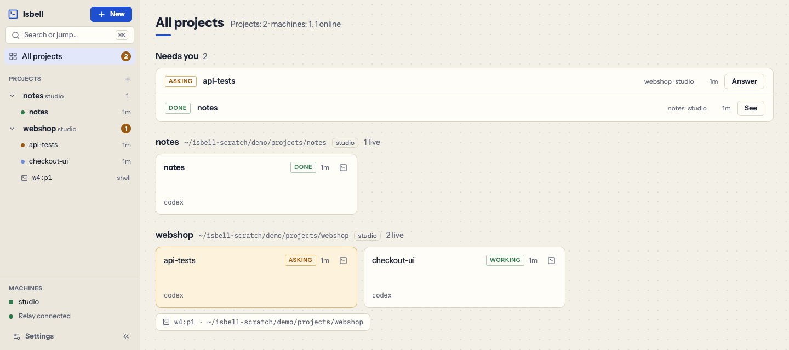

# Isbell

Reach the AI agents on your own machines from a browser. Isbell connects to
[herdr](https://github.com/herdrdev/herdr), the terminal workspace your agents (Codex, Claude Code,
…) run in, and shows every machine's sessions in one page: chat with them, answer what they ask,
start new ones, or take over their terminal.

**Open the app: <https://isbell.fmap.dev>**



Status: early development. macOS is what it runs on and is tested on today.

## How it works

- **gateway**: `isbell gateway run` on each machine, beside its herdr server. It only dials out,
  to the relay, and listens on no port.
- **relay**: matches browsers to gateways and carries the signalling for a WebRTC direct link
  between them. When no direct link can be opened, traffic goes through the relay instead.
- **web app**: the page at isbell.fmap.dev, a static site; it keeps nothing on a server.

A **space** groups your machines. Its key, made on your first machine, is the only credential:
whoever holds it can reach every machine in the space, so keep it as you would a password. The
key stays on your machines and in your browser; each connection signs a challenge with it and the
relay checks the signature, without ever receiving the key.

Traffic is protected by TLS, not encrypted end to end. Over a direct link it does not pass through
the relay. Through the relay, the relay sees it in passing; it logs no message content, and its
Redis keeps no data on disk.

## Install

1. Install herdr: <https://github.com/herdrdev/herdr>.
2. Install Rust: <https://rustup.rs>.
3. Install isbell:

   ```bash
   cargo install --git https://github.com/bencode/Isbell --locked isbell
   ```

## Quick start

On your first machine:

```bash
isbell space init          # creates your space and prints its key
isbell gateway install     # keeps the gateway running for this machine
```

Then open <https://isbell.fmap.dev> and paste the key.

On each other machine, with the key from the first:

```bash
isbell space join <key>
isbell gateway install
```

`isbell space show` prints the key again on any machine in the space.

`gateway install` runs `isbell gateway run` as a launchd user agent (macOS only): started at
login, restarted after a failure, logging to `~/Library/Logs/isbell/gateway.log`. It keeps the
`PATH` of the shell it ran in, so herdr and the agents are found; run it again after changing
`PATH` or moving the binary. The gateway starts the herdr server when it is not running, and never
stops it. `gateway status` and `gateway uninstall` check and remove the service. Elsewhere, run
`isbell gateway run` under a supervisor of your own.

The CLI reaches the same machines from a terminal:

```bash
isbell machine list
isbell machine probe <machine>     # tries a direct link and shows the way it goes
isbell terminal attach <machine>/<pane-or-agent> --control
```

## Self-hosting

`deploy/compose.yml` runs the public relay with its own Redis, and the web app as static files.
On the host, from the repository root:

```bash
docker compose -f deploy/compose.yml up -d --build
```

The host's TLS reverse proxy serves both at `isbell.fmap.dev`, by path:

| Path | Upstream |
|---|---|
| `/v1/*`, `/healthz` | relay on `172.17.0.1:5800` |
| everything else | web app on `172.17.0.1:5801` |

## Development

Requirements: Rust (stable), Docker.

```bash
docker compose up -d redis     # Redis without persistence, used by the relay
cargo run -p isbell-relay      # relay on 0.0.0.0:8787 (GET /healthz, WebSocket /v1/ws)
```

The relay exits when its Redis pub/sub connection is lost; run it under a supervisor that restarts it.

Relay configuration (environment variables):

| Variable | Default |
|---|---|
| `BIND` | `0.0.0.0:8787` |
| `REDIS_URL` | `redis://127.0.0.1:6379` |
| `PUBLIC_ORIGIN` | `ws://localhost:8787` |
| `TRUST_PROXY` | unset (`1` to use the last `x-forwarded-for` hop, the one added by the reverse proxy) |
| `LIMIT_IP_CONCURRENT` / `LIMIT_IP_PER_MINUTE` | `20` / `30` |
| `LIMIT_RATE` / `LIMIT_BURST` | `50` / `100` messages per client connection; beyond it clients get `rate_limited` |
| `LIMIT_GATEWAY_BYTES_PER_SEC` / `LIMIT_GATEWAY_BURST_BYTES` | 8 MiB / 16 MiB per gateway connection; beyond it the relay reads more slowly (frames are never dropped) |
| `LIMIT_INBOX_FRAMES` | `1024` messages waiting for one connection; a connection further behind is closed as too slow (code 4008) |

Try the gateway and CLI against a local relay and this machine's herdr server:

```bash
export ISBELL_RELAY=ws://localhost:8787/v1/ws
cargo run -p isbell -- space init
cargo run -p isbell -- gateway run &          # reports this machine's herdr agents
cargo run -p isbell -- machine list
cargo run -p isbell -- agent list
cargo run -p isbell -- agent prompt <machine>/<agent> "..." --wait
cargo run -p isbell -- watch                  # NDJSON presence and status changes
cargo run -p isbell -- terminal new <machine> --cwd '~/work'           # new shell, ctrl+] detaches
cargo run -p isbell -- terminal attach <machine>/<pane-or-agent>       # read-only
cargo run -p isbell -- terminal attach <machine>/<pane-or-agent> --control
```

| Variable | Purpose |
|---|---|
| `ISBELL_RELAY` | Relay URL (default `wss://isbell.fmap.dev/v1/ws`) |
| `ISBELL_KEY` | Space key, instead of this machine's key file |
| `ISBELL_CONFIG_DIR` | Config directory (default `~/.config/isbell`); a second directory simulates a second machine |
| `ISBELL_HERDR_SOCKET` | Use this herdr socket instead of discovering it with `herdr status` |
| `ISBELL_HERDR_BIN` | herdr executable the gateway runs (default `herdr` on `PATH`) |

Agents started through herdr inherit the herdr server's environment and the pane's login shell,
so settings such as `http_proxy` belong in the shell profile (e.g. `~/.zshrc`).

Checks (the relay and isbell integration tests need Redis running):

```bash
cargo test --workspace
cargo clippy --workspace --all-targets -- -D warnings
cargo fmt --all --check
```

### Web

Requirements: Node 24, pnpm 10. `web/` is the web app (React, Vite, Tailwind, Base UI); its
`src/model/` holds the protocol, the space connection, the project model and screen reading, with
no React. How its source is layered: [web/ARCHITECTURE.md](web/ARCHITECTURE.md).

```bash
cd web
pnpm install
pnpm dev                                               # workbench on http://localhost:5173
VITE_RELAY_URL=ws://localhost:8787/v1/ws pnpm dev      # against a local relay
```

The browser keeps the space key, settings and read marks in its own storage; nothing is stored on
the relay. Terminals open in the page: over a WebRTC direct link to the machine when one can be
opened (the gateway's `isbell.rtc.offer`, as the CLI uses it), otherwise over the relay. `crates/isbell-proto/tests/vectors.json` is shared by the Rust and TypeScript tests so
both ends encode frames and sign identically.

```bash
pnpm typecheck && pnpm test && pnpm lint && pnpm build
```
