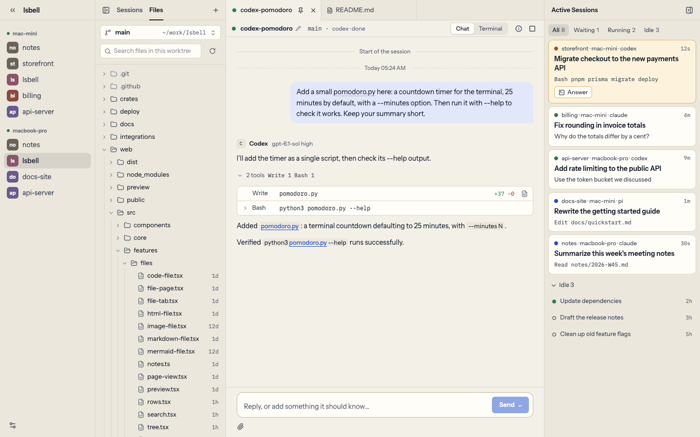
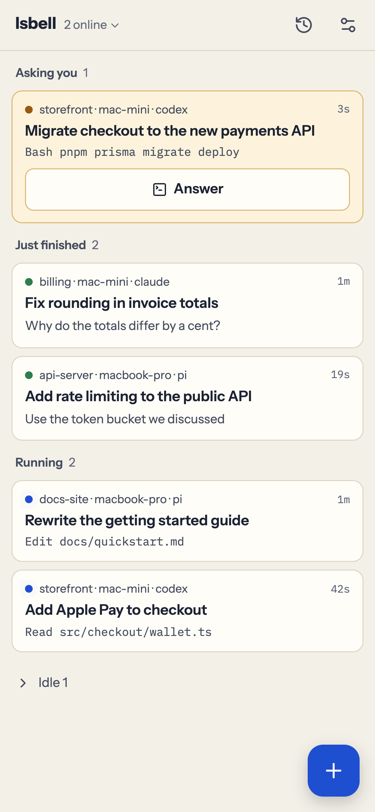

# Isbell

Run AI coding agents on your own Macs. Watch them, answer them and read what they write from any
browser or your iPhone.



An agent can work for an hour and then stop to ask you one question. Isbell is for that moment:

- **Every agent in one place**, across all your machines, the ones waiting for you first.
- **Answer from anywhere**: reply in a chat, or work in the agent's real terminal, from a browser
  or your phone. Your iPhone can tell you when an agent needs you.
- **See what they made**: Markdown, code, diagrams, images and HTML pages, without opening an editor.
- **Nothing to expose**: your Macs open no port, and the server stores none of your data.

Your agents keep running on your own Macs, inside [herdr](https://herdr.dev), the terminal workspace
Isbell connects to. Isbell does not replace them or run any model.

Status: early development. The public server at `isbell.fmap.dev` is provided as is, with no
guarantee of availability; you can [run your own](#self-hosting).

## What you need

- A Mac with Apple silicon. On other systems, [build from source](#from-source).
- [herdr](https://herdr.dev). Setup offers to install it.
- An agent. Claude Code, Codex and pi are fully supported; any other works through the Terminal.

Isbell only sees what runs inside herdr, so start your agents there.

## Set up

Paste this to the agent on your Mac (Claude Code, Codex, …):

```text
Set up Isbell on this Mac: read https://raw.githubusercontent.com/bencode/Isbell/main/docs/setup.md and follow it.
```

It installs `isbell` (and herdr, if you agree) and runs the gateway. It never sees your space key.
Then:

1. Run `isbell space show` in your own terminal and copy the key.
2. Open <https://isbell.fmap.dev> and paste it.
3. Run `herdr` and start your agents in it.

The key is the only credential for your space: anyone who has it can reach the agents on your
machines, so keep it to yourself. For another Mac, paste the same text to the agent there, and run
`isbell space join <key>` yourself when it asks.

Setup also offers a small hook for Claude Code, Codex and pi. It puts what each agent was asked and
what it is doing on its card, and records sessions so that you can find and resume them after their
pane is closed.

## What it does

### On a computer

- **Workbench**: your projects, each one's sessions and files, and a tab for whatever you open, in
  one window that remembers where you were.
- **Active Sessions**: every agent on all your machines, the ones asking first, then those just
  finished and those running.
- **Look without leaving**: open a session in a drawer over your work and answer the agent there.
  ⌘K finds any agent.
- **Chat**: a session reads as turns, from the agent's own record; reply, or answer what it asks in
  its terminal ([Codex needs `--no-daemon`](docs/setup.md)).
- **Terminal**: work in any pane from the browser; paste or drop in a file to hand it to the agent.
- **Files**: read what the agents write, on any worktree. Markdown with its outline, math and
  diagrams; source with highlighting; images; HTML pages, run apart from the app.
- **Sessions**: a project's past sessions by day, to search, read again or resume.
- **New**: start an agent or a shell in a project, on any machine.
- **Notifications** when an agent asks or finishes, while Isbell is open in a tab.

### On your iPhone



A remote control for when you are away from your computer, with a layout of its own:

- See every session, the ones asking you first, and get a push when an agent asks or finishes, even
  with Isbell closed.
- Read a session as a chat and reply, or answer in its terminal with a bar of the keys agents ask
  for.
- Read the files agents write, start a new session, and find and resume past ones.

To set it up:

1. Open <https://isbell.fmap.dev> in Safari, then Share → Add to Home Screen.
2. Open Isbell from the Home Screen and paste your key.
3. In Settings, turn on **Push to this iPhone**. Pushes need `isbell` 0.3.0 or later on your machines.

After an update, close the app completely and open it again to get the new version.

## CLI

`isbell` does the same from a terminal, and copies files between machines:

```bash
isbell machine list
isbell machine probe <machine>                        # tries a direct link, shows its path
isbell agent prompt <machine>/<agent> "..." --wait
isbell terminal attach <machine>/<pane-or-agent> --control
isbell file get <machine>:<absolute path>
```

## Privacy and how it works

```text
+----------------------- relay server -------------------------+
|  relay <--> Redis: in memory only, every key expires         |
|  stores no user data, logs no message content                |
+-----^---------------------------------------------^----------+
      |                                             |
      | WSS: status,                                | WSS, dialled out
      | small calls                                 | by the gateway
      |                                             |
+-----+--------------+                 +------------+---------------+
| Browser            |     WebRTC      | Each of your Macs          |
| isbell.fmap.dev    |<===============>| gateway -- herdr -- agents |
+--------------------+     direct      +----------------------------+
     terminal and files go direct; through the relay only if that fails
```

- **No user data on the server**: the relay only pairs browsers with gateways and passes messages
  along. Redis holds routing and each machine's last status, all expiring within 15 minutes, never
  on disk. Your key, settings and read marks stay on your machines and in your browser.
- **Direct first**: terminals and files go over a WebRTC direct link; when none can be opened, the
  same traffic goes through the relay.
- **TLS, not end to end**: what goes through the relay is visible to the relay as it passes. If that
  matters to you, [run your own](#self-hosting).
- **One key per space**: each connection signs with the key, and the relay checks the signature
  without ever receiving it.
- **Gateways only dial out**: a machine opens no port.
- **Pages run apart**: an HTML page from a project runs on an origin of its own, so its scripts
  cannot reach the app or your key.

## Install by hand

```bash
curl -fsSL https://isbell.fmap.dev/install.sh | sh
```

This installs the latest release to `~/.local/bin/isbell` after checking its checksum, and offers
herdr's own installer when herdr is missing. Then:

1. On your first machine: `isbell space init`, which creates your space and prints its key.
2. `isbell gateway install`, which keeps the gateway running on this machine.
3. Open <https://isbell.fmap.dev> and paste the key.
4. On each other machine: `isbell space join <key>`, then `isbell gateway install`.

- `isbell space show` prints the key again on any machine in the space.
- `gateway install` makes a launchd user agent: started at login, restarted after a failure, logging
  to `~/Library/Logs/isbell/gateway.log`. It keeps the `PATH` of the shell it ran in, so herdr and
  the agents are found; run it again after changing `PATH`.
- `gateway status` and `gateway uninstall` check and remove it.

### Upgrade and uninstall

- `isbell upgrade` installs the latest release and restarts the gateway. The web app marks a machine
  on an older version in the sidebar.
- `ISBELL_VERSION=v0.1.0` before `sh` in the install command installs that release instead.
- To remove Isbell, see [Uninstall](docs/setup.md#uninstall).

### From source

On other systems, or to run `main`, with Rust (<https://rustup.rs>) and herdr installed:

```bash
cargo install --git https://github.com/bencode/Isbell --locked isbell
```

Where `gateway install` is not available, run `isbell gateway run` under a supervisor of your own.

## Self-hosting

`deploy/compose.yml` runs the relay with its own Redis, and the web app as static files. It is set up
for `isbell.fmap.dev`, so point it at your own domain:

1. In `deploy/compose.yml`, set `PUBLIC_ORIGIN` to `wss://your.domain` and adjust the published ports.
2. Create `web/.env.production`:

   ```bash
   VITE_RELAY_URL=wss://your.domain/v1/ws
   VITE_PREVIEW_ORIGIN=https://preview.your.domain
   ```

3. From the repository root: `docker compose -f deploy/compose.yml up -d --build`.
4. Put a TLS reverse proxy in front:

   | Site, path | Upstream |
   |---|---|
   | `your.domain` `/v1/*`, `/healthz` | relay, port 5800 |
   | `your.domain`, everything else | web app, port 5801 |
   | `preview.your.domain` | preview origin, port 5802 |

5. On each machine, before creating or joining a space, add `relay = "wss://your.domain/v1/ws"` to
   `~/.config/isbell/config.toml`, or set `ISBELL_RELAY`.

## Development

Building, running a local relay, tests and releasing: [docs/development.md](docs/development.md).

## License

[MIT](LICENSE)
